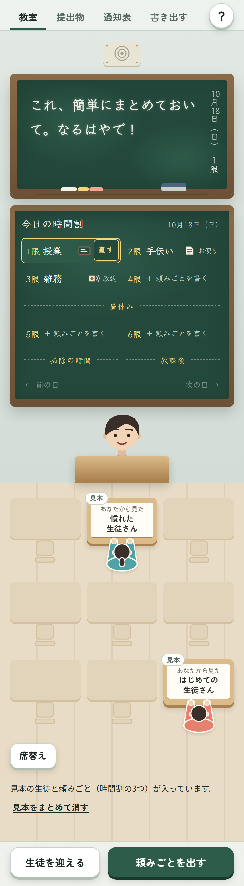

# マネジメント教室

（旧名「せきがえ」。ページのアドレスは前のままです）

先輩・上司・先生が、「自分の頼み方が、相手の席からどう見えているか」を確かめるためのページです。
教室の形をしていて、自分（先生）が頼みごとを出し（黒板・お便り・放送）、相手は生徒として席に着きます。

**開くページ:** https://yucca-1122.github.io/sekigae/

スマホのブラウザで開いて「ホーム画面に追加」すると、アプリのように全画面で使えます。

## できること
- **頼みごとを出す** … 伝え方を「黒板（その場で説明）」「お便り（文字で配る）」「放送（口や Zoom で伝えた）」から選んで出します。科目名（ゼミ・授業・雑務・手伝い・その他、または自分で書く）、誰に向けた頼みか、「この人には初めての作業」かも選べます。あとから直せます
- **今日の時間割** … 1〜6限の枠があり（4限のあとに昼休み、6限のあとに掃除）、出した頼みがその時限に入ります。空いている時限を押すと、そこに頼みごとを書けます。埋まっている時限を押すと、大きい黒板がその頼みに切り替わります。前の日・次の日も見られます。日付は午前3時に切り替わります（0時〜2時台は前の日として数えます）
- **掃除の時間** … 1日の終わりに、今日の頼みを黒板に1枚ずつ出して、相手ごとに「終わった・途中・まだ」を選びます。途中なら「続き（いつ・どこから）」、まだなら「最初の一歩」を一言書きます。途中・まだのものは、次の日の時間割の下に「前の日からの続き」として出ます
- **昼休み** … 時間割の「昼休み」を押すと、生徒が席を離れて近くの席どうしで集まります（先生は教卓で休けい）。生徒を押すと「話を聞いた（雑談）」を、何の話かの一言と「相手の話を最後まで聞けた」の印つきで記録できます。昼休みの間は頼みごとを出せません。「授業にもどる」を押すまで、開き直しても昼休みのままです
- **生徒の目線** … 生徒の机を押すと、その生徒の目線にふわっと切り替わります。あいまいな言葉がにじみ、足りないもの（何のため？・どこまで？・何分？・いつまで？など）が吹き出しで出ます。お便りは机の上の紙、放送は消えかけた文字で見えます。先生の顔の見え方、生徒の心の声（「〜かも」。その日に頼みが重なったときの声も）、本人に確かめるならの一言、足すとよいものも出ます
- **提出物** … 返ってきたものを6つから選んで「提出」します。全員そろうか「締める」と「これまでの提出物」に残り、あとで見直せます。何人もずれたら、まず黒板を見直す合図が出ます
- **先生の通知表** … 出した頼みごとから、「求める（はっきりさ・言い切る・仕組み）」と「支える（手厚さと任せ方・返し方・報いる）」の地図に、自分の位置が出ます。伝え方の内訳と、放送だけで終わった頼みの数も出ます。「話を聞いた」の記録は「支える」に小さく足されます（回数では増えません）
- **生徒カード** … 生徒は「あなたから見たその人（いまのところ）」として、5つの問いで作ります。能力ではなく「どう伝えると届くか」を聞きます。いつでも書き直せて、前の答えも残ります
- **書き出す** … 自分の癖と生徒ごとの記録を、Markdown の文にしてコピーできます
- **席替え** … 前後は「慣れ」のまま、左右の席をくじで入れ替えます

## 考え方
- 生徒の目線は、黒板の文を言葉の一覧で読んで作る「仮の見え方」です。AI は使っていません。本当の見え方は、本人に聞いて、返ってきたものを記録して確かめます
- 生徒は本人の評価ではありません。席の前後は「言葉が届くのに必要なはっきりさ」で、出来の良し悪しではありません
- 6つの軸や見え方の決まりは、上司のふるまい・目標の立て方・フィードバック・心理的安全性などのまとめの調査（メタ分析）を中心に、よく引用されていて追試でも崩れていないものを選んで作りました
- 伝え方の違い（口だけの説明は残りにくく、要点を文字でも渡すと残りやすい）や、頼みが重なる・途中で次を頼むときの負担も、同じやり方で確かめた研究のまとめをもとにしています。「1日3本」などの線は目安です
- 掃除の時間は、記録を見ながらふりかえることと、続きを「いつ・どこから」やるか先に決めておくことの研究のまとめをもとにしています
- 昼休みの「話を聞いた」は、話した回数より「聞いてもらえた感じ」のほうが関係の良さと結びつく、という研究のまとめをもとに、回数ではなく「聞けたか」を残します

## データ
- 生徒・頼みごと・記録は、使っている端末のブラウザの中にだけ保存されます。どこにも送りません
- 外から読み込むのは、文字の形（Google Fonts）だけです
- 見本の生徒と頼みごと（時間割の3つ）が入っています。「見本をまとめて消す」で消せます

## ファイル
- `index.html` … 開くページ（`sekigae.html` から `tools/build_pages.py` で作ります）
- `sekigae.html` … 本体
- `manifest.webmanifest`・`assets/icons/` … ホーム画面に追加したときの名前とアイコン
- `tools/` … アイコンを作る道具・ページを作る道具・試験（`node tools/test_engine.mjs`・`node tools/test_ui.mjs`）

## 権利
このリポジトリにはライセンスを付けていません。権利は作者にあります。転載・改変・再配布はご遠慮ください。
